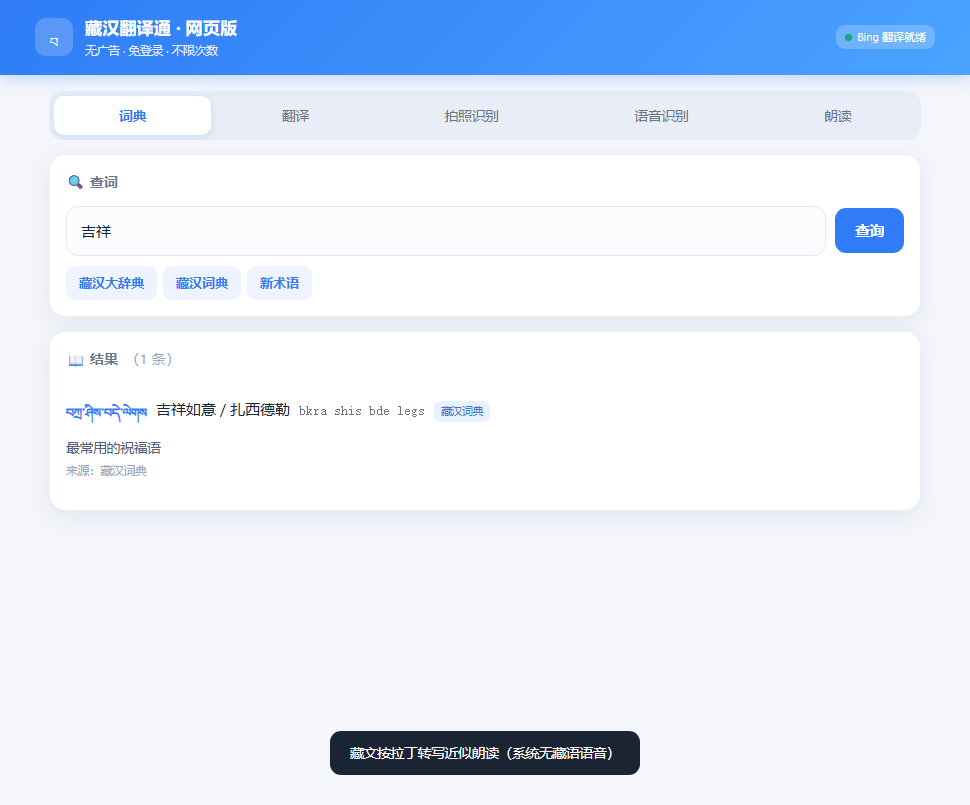
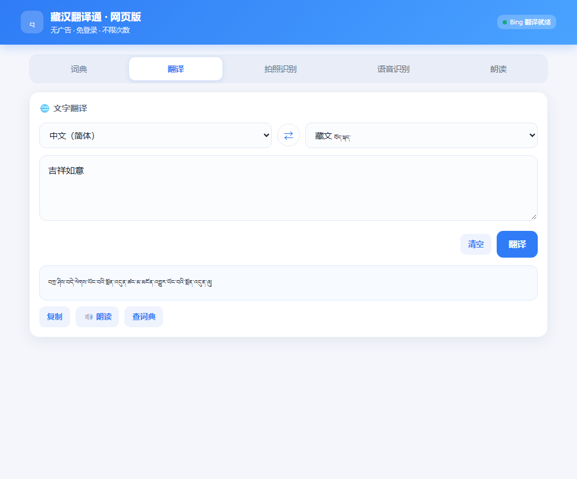
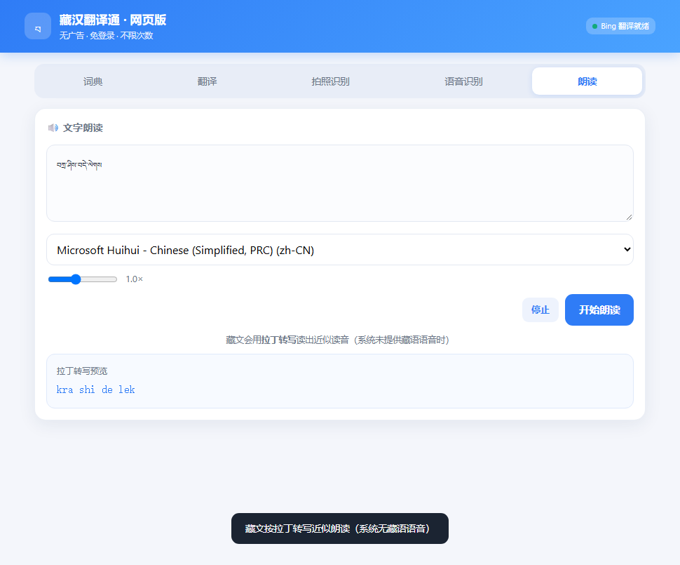

# 藏汉翻译通 · 网页版

> 无广告、免登录、不限次数的藏汉词典与翻译工具。纯本地运行，零依赖，双击即用。

一个从 Android APK 逆向重写而来的网页版实现：保留原应用的藏汉词典、文字翻译、拍照识别、语音识别、文字朗读五项功能，去掉了广告、登录和次数限制，并做成了跨平台的网页应用。

<p align="center">
  
</p>

---

## 特性

| 功能 | 实现方式 | 是否需要配置 |
|---|---|---|
| **藏汉词典** | 内置词库，支持藏文 / 中文 / 拼音三向查询 | — |
| **藏汉大辞典** | 内置词库（佛学、典籍术语） | — |
| **新术语** | 内置词库（现代词汇） | — |
| **文字翻译** | Bing 翻译免费通道，中藏双向互译 | — |
| **OCR 拍照翻译** | Tesseract.js 纯浏览器本地识别 | — |
| **语音识别** | Web Speech API | — |
| **文字朗读** | SpeechSynthesis + 藏文转写引擎 | — |

- **零依赖**：只用 Node 内置模块，无需 `npm install`
- **无 Key 可用**：翻译走 Bing 免费通道，词典完全离线
- **隐私安全**：除翻译请求外全部本地完成，不上传任何数据
- **跨平台**：手机 / 电脑 / 平板通用，浏览器打开即用

---

## 快速开始

```bash
# 需要 Node.js 18+
node server.js
```

Windows 用户可直接双击 `启动.bat`。

浏览器打开 **http://127.0.0.1:5300**

无需任何配置。如需改用微软官方翻译（额度更稳），见下方「可选配置」。

---

## 截图

| 翻译 | 藏文朗读 |
|---|---|
|  |  |

---

## 技术实现

### 翻译：Bing 免费通道

藏文属于小语种，主流免费翻译接口基本不支持。实测结果：

| 服务 | 支持藏文 | 免 Key | 结论 |
|---|---|---|---|
| Google `translate_a/single` | ✅ | ✅ | 大陆网络超时 |
| 有道词典 API | ❌ | ✅ | 不支持 `bo` |
| LibreTranslate 公共实例 | 部分 | ✅ | 返回 403 |
| 百度翻译 | ❌ | — | 接口不公开 |
| **Bing 网页翻译** | ✅ | ✅ | **采用** |

实现思路：Bing 翻译页内置匿名 token，服务端抓取页面提取 `IG` / `IID` / `abuse-prevention key`，再调用其 `ttranslatev3` 接口。token 约 10 分钟过期，代码里做了缓存与自动重取。

### 藏文朗读：为什么需要转写引擎

实测三平台，**均无藏语 TTS 语音**：

| 平台 | 语言/语音数 | 藏语 | 验证方式 |
|---|---|---|---|
| Windows 系统语音 | 2 个（zh-CN, en-US） | ❌ | `GetInstalledVoices()` |
| eSpeak-ng（开源） | 128 种语言 | ❌ | 数据包 `lang/sit/` 仅含 cmn/hak/my/yue |
| Edge / Azure 在线 TTS | 322 语音 / 142 语言 | ❌ | voices 列表无 `bo` locale |

> 注：eSpeak 数据包里出现的 `bo_dict` 实为 `jbo_dict`（Lojban 逻辑语），并非藏语 `bo`。

因此本程序内置**音节级转写引擎**，按藏文拼读规则转成拉丁音节，再交给本地语音朗读：

| 藏文 | 转写结果 | 汉语对应 |
|---|---|---|
| བཀྲ་ཤིས་བདེ་ལེགས | `kra shi de lek` | 扎西德勒 |
| ཐུགས་རྗེ་ཆེ | `thuk rje chhe` | 突杰切（谢谢） |
| ང་བོད་སྐད་སློབ་སྦྱོང་བྱེད་ཀྱི་ཡོད | `nga bo ska slo sbyong bye kyi yo` | 我在学藏语 |

转写规则：

1. 以 `་`、空格、`།` 切分音节
2. 由元音符号决定韵母，无元音符号则默认 `a`
3. 前加字（ག ད བ མ འ）按口语省略；若其后跟下加字则保留为基字
4. 下加字与基字合流（ྲ→r、ླ→l、ྱ→y、ྭ→w）
5. 后加字按口语弱化（ད བ ལ ས འ 不发音；ག→k、ང→ng、ན→n、མ→m、ར→r）

### 词典

内置 184 条词条（藏汉词典 79 / 大辞典 50 / 新术语 55），存于 `dict.json`。查询采用三级匹配：完全匹配 → 前缀匹配 → 包含匹配，支持藏文、中文、拼音三种输入。

---

## 项目结构

```
zanghan-web/
├── index.html            单页应用（含藏文转写引擎）
├── server.js             本地服务 + 翻译代理
├── bing.js               Bing 免 Key 翻译模块
├── dict.json             内置词库（可自由增删）
├── config.example.json   配置模板
├── 启动.bat              Windows 启动脚本
├── LICENSE
└── README.md
```

---

## 可选配置

复制配置模板：

```bash
cp config.example.json config.json
```

填入微软 Translator 的 Key（每月 200 万字符免费）：

```json
{
  "ms_key": "你的KEY1",
  "ms_region": "eastasia",
  "port": 5300
}
```

申请地址：<https://portal.azure.com> → 搜索 Translator → 创建 → 定价层选 **F0（免费）**。

配置后服务优先走微软通道，失败自动回落 Bing。

---

## 扩充词库

编辑 `dict.json`，向对应数组追加词条：

```json
{
  "bo": "བཀྲ་ཤིས་བདེ་ལེགས",
  "zh": "吉祥如意 / 扎西德勒",
  "py": "bkra shis bde legs",
  "desc": "最常用的祝福语",
  "src": "藏汉词典"
}
```

| 数组 | 用途 |
|---|---|
| `words[]` | 藏汉词典（日常用语） |
| `big[]` | 藏汉大辞典（佛学 / 典籍） |
| `terms[]` | 新术语（现代词汇） |

改完重启服务生效。

---

## 已知限制

**藏文朗读是近似读音**，并非真正的藏语语音合成。需要真人级藏语朗读时，目前可选：

- 讯飞开放平台藏语语音合成（需注册，有免费额度）
- 自行部署藏语 TTS 模型（HuggingFace 上有 VITS 系列模型）

**藏语语音识别不受支持**：Web Speech API 未提供藏语识别，这是浏览器层面的限制。

**藏文 OCR 精度有限**：识别效果受字体与图片质量影响，截图或扫描件效果最好。

**Bing 通道非官方接口**：对方随时可能调整，若失效可配置微软 Key 走官方通道。

---

## 免责声明

本项目仅供学习与技术研究使用。翻译服务由第三方提供，其可用性不由本项目保证。请遵守相关服务的使用条款。

---

## License

[MIT](LICENSE)
